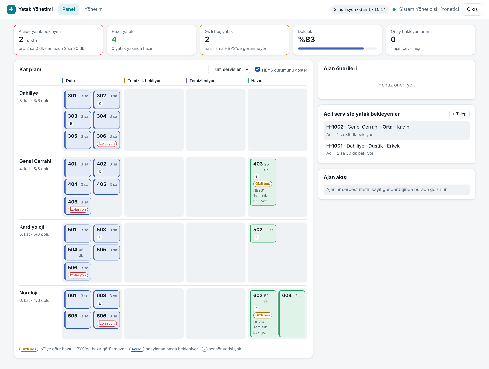

# IoT Destekli Çok Ajanlı Hastane Yatak Yönetimi

İstanbul Sağlık ve Teknoloji Üniversitesi, Bilgisayar Mühendisliği bitirme projesi.
Ekip: Erva Ergül (IoT katmanı, oda durumu çıkarımı, sanal sensörler, web paneli), Cengizhan Karaman (hastane simülatörü, yapay zekâ ajanları, kısıt katmanı). Danışman: Dr. Öğr. Üyesi Nazlı Nakeeb Tokatlı.



## Ne yapar
- Hasta odasındaki sensörlerden (yatak yük hücresi, PIR, kapı) odanın durumunu gerçek zamanlı çıkarır: **Dolu → Temizlik bekliyor → Temizleniyor → Hazır** (veri yoksa Bilinmiyor).
- HBYS'ye elle ve geç girilen durumla karşılaştırır: hazır olduğu halde HBYS'de görünmeyen yatak = **gizli boş yatak**.
- Acil serviste yatak bekleyen hastalar için ajanlar en fazla 3 aday oda önerir. Sunucu branş, cinsiyet, izolasyon ve hazır olma kurallarını denetler; **son karar paneldeki kullanıcıdadır**.
- Panel: üstte göstergeler, ortada servis servis kanban kat planı (odalar durum değiştikçe sütunlar arasında kayar), sağda ajan önerileri (onayla/reddet) ve bekleyen hastalar.

## Çalıştırma
```bash
cd backend
pip install -r requirements.txt
HASTANE_ADMIN_PASSWORD='guclu-bir-parola' uvicorn app.main:app --port 8000
```
Tarayıcıda `http://localhost:8000` açın, `admin` ile girin. Parola verilmezse sunucu üretir ve `backend/data/ilk-yonetici-parolasi.txt` dosyasına yazar. API belgesi: `http://localhost:8000/docs`.

Testler: `cd backend && python -m pytest -q`

## Mimari
```
ESP32 oda düğümü ──HTTP/MQTT──┐                                   ┌── Panel (frontend/)
Sanal sensörler (simülatör) ──┼──► Çekirdek ── oda durumu çıkarımı ◄┤
Dış ajanlar (LLM) ────────────┘    talepler · öneriler · kısıtlar    └── Yönetim
                                   │
                              Olay yolu (services/bus.py) ──► adaptörler (MQTT, simülatör, temel ajan ...)
```
- **Çekirdek** (`services/core.py`, `services/flow.py`) tek yerdir: veri nereden gelirse gelsin aynı kurallardan geçer.
- **Oda durumu çıkarımı** (`services/room_state.py`) veritabanı bilmeyen saf bir fonksiyondur; laboratuvar kayıtları üzerinde çevrimdışı da çalıştırılıp F1 ve gecikme ölçülebilir. ML sınıflandırıcı gelince oda `{"inference": "external"}` yapılır.
- **Adaptörler** (`backend/app/adapters/`) birbirinden bağımsızdır; biri çökerse sunucu ayakta kalır ve adaptör yeniden başlar.
- **Sözleşmeler:** [docs/API.md](docs/API.md) ve IoT → ajan veri biçimi [docs/interface.md](docs/interface.md).

## Ayarlar (ortam değişkenleri)
| Değişken | Varsayılan | Açıklama |
|---|---|---|
| `HASTANE_DATABASE_URL` | `sqlite:///backend/data/hastane.db` | PostgreSQL de olur |
| `HASTANE_ADMIN_USER` / `HASTANE_ADMIN_PASSWORD` | `admin` / üretilir | İlk yönetici |
| `HASTANE_SIMULATOR` | `1` | Sanal sensörler ve hasta akışı (24 oda) |
| `HASTANE_SIM_SPEED` | `60` | Simülasyon hızı (60x: bir gün 24 dk) |
| `HASTANE_SIM_DROP`, `HASTANE_SIM_NOISE` | `0`, `0` | Sensör arızası: veri kaybı ve hatalı okuma oranı (0–1) |
| `HASTANE_HIS_DELAY_MIN` | `60` | HBYS'ye "hazır" girişinin ortalama gecikmesi (sim dakikası) |
| `HASTANE_SIM_ED_RATE` | `0.2` | Oda başına günlük acil yatış talebi |
| `HASTANE_RULE_AGENT` | `1` | Yerleşik kural tabanlı atama ajanı (temel yöntem) |
| `HASTANE_AUTO_APPROVE_S` | `0` | Demo: öneriyi N sn sonra otomatik onayla (0 = kapalı) |
| `HASTANE_MQTT`, `HASTANE_MQTT_HOST`, `HASTANE_MQTT_PORT` | `0`, `localhost`, `1883` | MQTT köprüsü |
| `HASTANE_SECRET_KEY` | üretilir | Oturum imzalama anahtarı |

Not: Bitirme deneyindeki asıl hastane simülatörü (SimPy, 4 servis ~120 yatak) ayrı bir modüldür; buradaki simülatör panelin canlı çalışmasını ve uçtan uca entegrasyonu göstermek içindir.
