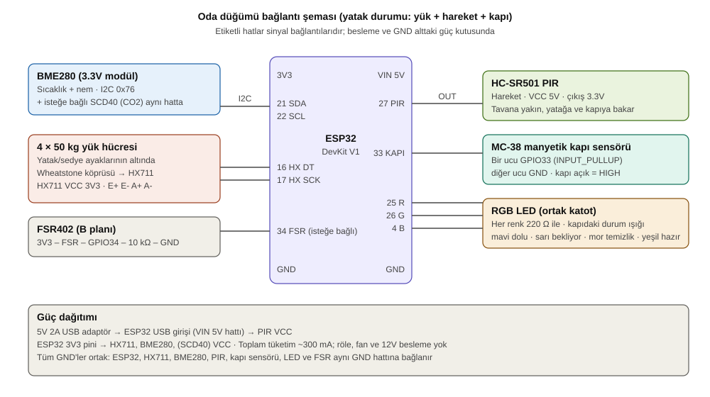

# Oda düğümü: devre bağlantı şeması

Laboratuvardaki örnek hasta odasının durumunu (dolu / temizlik bekliyor / temizleniyor / hazır) çıkarmak için ESP32 düğümü. Düğüm `docs/API.md`'deki cihaz akışıyla sunucuya bağlanır ve 5 sn'de bir şunu gönderir:

```json
{"metrics": {"bed_load_kg": 71.5, "motion": 2, "door_events": 1, "temp_c": 22.8, "humidity": 44.1}}
```

`motion` = son ölçümden bu yana PIR tetik sayısı, `door_events` = kapının kaç kez açıldığı. Durumu sunucu çıkarır (`backend/app/services/room_state.py`); düğüm yalnızca ölçer.



## Pin atamaları

| Parça | Parça pini | ESP32 pini | Not |
|---|---|---|---|
| HX711 (yük hücresi yükseltici) | VCC | 3V3 | 3.3V ile beslenince DT çıkışı da 3.3V olur |
| | GND | GND | |
| | DT (DOUT) | GPIO16 | |
| | SCK (PD_SCK) | GPIO17 | |
| | E+ / E- / A+ / A- | 4 yük hücresinin köprüsü | Bkz. "Yük hücresi bağlantısı" |
| HC-SR501 PIR | VCC | 5V (VIN) | |
| | OUT | GPIO27 | Çıkış 3.3V, doğrudan bağlanır; kesme (interrupt) ile sayılır |
| | GND | GND | |
| MC-38 manyetik kapı sensörü | uç 1 | GPIO33 | `INPUT_PULLUP`; kapı kapalı = LOW, açık = HIGH |
| | uç 2 | GND | |
| BME280 (3.3V modül) | VCC / GND | 3V3 / GND | **BMP280 değil**: BMP280 nem ölçmez |
| | SDA / SCL | GPIO21 / GPIO22 | I2C adres 0x76 (SDO → GND) |
| SCD40 (isteğe bağlı, CO2) | VCC / GND / SDA / SCL | 3V3 / GND / 21 / 22 | Aynı I2C hattı, adres 0x62 |
| RGB LED (ortak katot) | R / G / B | GPIO25 / GPIO26 / GPIO4 | Her renge 220 Ω seri direnç; ortak uç GND |
| FSR402 (B planı) | bir uç | 3V3 | Diğer uç GPIO34'e ve 10 kΩ ile GND'ye (gerilim bölücü) |

Komut eşlemesi: sunucudan gelen `led` komutunun değeri durumu gösterir: 0 kapalı, 1 dolu (mavi), 2 temizlik bekliyor (sarı), 3 temizleniyor (mor), 4 hazır (yeşil).

## Yük hücresi bağlantısı

- 4 adet 50 kg yarım köprü (3 telli) yük hücresi yatağın ya da sedyenin 4 ayağının altına konur. Toplam kapasite 200 kg.
- Dört hücre tek bir Wheatstone köprüsü olacak şekilde bağlanır. En kolay yol "yük hücresi birleştirme kartı" (combinator) kullanmaktır; kart çıkışı HX711'in E+, E-, A+, A- uçlarına gider.
- Kart yoksa: karşılıklı hücrelerin beyaz ve siyah telleri birbirine bağlanır, kırmızı teller köprünün çıkışlarıdır. Telin renkleri üreticiye göre değişebilir; önce multimetreyle orta ucu (en yüksek direnç farkı) bulun.
- Her hücre düz ve sert bir zemine (MDF plaka ya da 3D baskı tutucu) oturmalı; hücrenin ortadaki esneyen kısmı boşta kalmalı.
- **Kalibrasyon:** boş yatakta dara alın (`tare`), ardından bilinen bir ağırlık (ör. 20 kg) koyup ölçek katsayısını hesaplayın. Katsayıyı ESP32'nin kalıcı belleğine yazın.
- Eşik: sunucuda varsayılan 20 kg üstü "yatakta hasta var" sayılır (oda ayarı `load_kg`).

## Güç

- 5V 2A USB adaptör → ESP32'nin USB girişi. PIR, VIN (5V) pininden; HX711, BME280 ve SCD40, ESP32'nin 3V3 pininden beslenir.
- Yaklaşık tüketim: ESP32 Wi-Fi tepe ~250 mA, PIR ~1 mA, HX711 ~1.5 mA, BME280 < 1 mA, LED ~20 mA. Toplam ~300 mA.
- Şebeke gerilimine hiçbir şey bağlanmaz; düğüm yalnızca 5V USB ile çalışır.
- Tüm GND'ler ortaktır.

## Uyarılar

1. **3.3V lojik:** ESP32 pinleri 5V'a dayanıklı değildir. HX711'i 3V3'ten besleyin; PIR çıkışı zaten 3.3V'tur. I2C modüllerini 5V'tan beslemeyin.
2. **Kaçınılan pinler:** GPIO0, 2, 5, 12, 15 açılış pinleridir; GPIO6-11 flaşa aittir; GPIO34-39 yalnız giriştir (FSR için GPIO34 bu yüzden uygundur, ADC1 kanalı olduğu için Wi-Fi açıkken de okunur).
3. **PIR ayarı:** jumper "H" (tekrar tetiklemeli), süre potu en düşük (~3 sn), hassasiyet orta. Açılıştan sonra ~60 sn ısınma beklenir. Hareket sayısı yazılımda kesmeyle sayılır ve her gönderimde sıfırlanır.
4. **Kapı sensörü:** mıknatıs kapıya, gövde kasaya yapıştırılır; aradaki boşluk kapalıyken 1 cm'den az olmalı. Yazılımda 50 ms sıçrama (debounce) filtresi kullanın.
5. **Sensör yerleşimi:** PIR'ı yatak ve kapı alanını görecek şekilde tavana yakın koyun; BME280'i ESP32'nin ısısından birkaç cm uzakta tutun.
6. **Gizlilik:** kamera ve mikrofon kullanılmaz; sensörler kişiyi tanımlayan veri üretmez.

## Kurulum sırası (önerilen)

1. ESP32'yi tek başına USB ile çalıştırıp Wi-Fi'ye bağlayın ve `POST /devices/me/telemetry` ile sahte değer gönderin. Panelde Yönetim > Cihazlar'dan cihazı odaya atayın; simülatör o odayı bırakır.
2. HX711 + 4 yük hücresini bağlayın, dara alın ve kalibre edin. Panelde oda durumunun "Dolu" ↔ "Temizlik bekliyor" arasında değiştiğini görün.
3. PIR'ı ekleyin: odada dolaşınca durum "Temizleniyor"a, 10 dk sessizlikte "Hazır"a geçmeli.
4. Kapı sensörünü ve BME280'i ekleyin.
5. RGB LED'i en son ekleyin ve `led` komutunu deneyin.
6. Laboratuvar kayıtlarında senaryoları canlandırırken panelde oda detayından "Etiketle" ile gerçek durumu işaretleyin.

## Alınacaklar listesi (2 oda düğümü)

Önce bölüm laboratuvarındaki setleri kontrol edin; ESP32, PIR, breadboard ve kablolar büyük olasılıkla vardır.

| Parça | Adet | Not |
|---|---|---|
| ESP32 DevKit V1 (30 pin, CP2102 ya da CH340) | 2 (+1 yedek) | |
| 50 kg yarım köprü yük hücresi + HX711 seti (4 hücre + 1 HX711) | 2 set | "4'lü 50 kg tartı sensörü + HX711" olarak satılır |
| Yük hücresi birleştirme kartı (combinator) | 2 | İsteğe bağlı; lehim işini azaltır |
| Yük hücresi tutucu (3D baskı) ya da 4 adet MDF plaka | 8 | Hücre ortası boşta kalmalı |
| HC-SR501 PIR hareket sensörü | 2 | |
| MC-38 manyetik kapı sensörü | 2 | |
| BME280 sıcaklık-nem modülü (3.3V, I2C) | 2 | BMP280 almayın |
| RGB LED, ortak katot (5 mm) | 2 | |
| 220 Ω direnç | 6 | |
| FSR402 kuvvet sensörü + 10 kΩ direnç | 2 + 2 | B planı: yük hücresi güvenilmez olursa |
| Breadboard (830 delik) | 2 | |
| Jumper kablo seti (erkek-erkek, erkek-dişi, dişi-dişi) | 1 | |
| 5V 2A USB adaptör + veri destekli mikro USB kablo | 2 | |
| Kalibrasyon için bilinen ağırlık (ör. 5 L su bidonu ×4) | 1 | 20 kg civarı |
| Çift taraflı bant, kablo bağı, makaron | 1 | |
| SCD40 CO2 sensörü | 0–1 | İsteğe bağlı; proje için şart değil |
